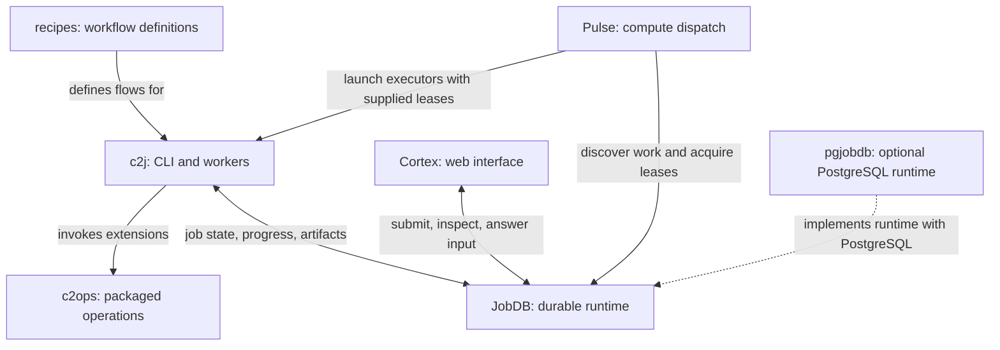

# C2: durable distributed workflow execution

C2 is a collection of projects for defining, running, and observing durable
workflows across workers and compute environments. Workflows preserve execution
progress, coordinate child jobs, and pause for dependencies or human decisions.
Recorded state lets work resume across execution sessions instead of relying on
one continuously running process.

The core is **recipes** for workflow definitions, **c2j** for execution,
**c2ops** for extension operations, **Pulse** for compute dispatch, and **Cortex**
for the human interface. **JobDB** supplies the shared durable runtime;
**pgjobdb** adds a PostgreSQL implementation option.

## How the system fits together



Recipes describe control flow, inputs, dependencies, and operations. c2j executes
that flow in workers and records progress through JobDB. Operations may be built
into c2j or supplied by packages such as c2ops, whose integrations include agents,
LLMs, GitHub Actions, and policy checks.

Pulse discovers eligible work across a JobDB tenant, acquires job leases, and
launches compatible executors on local Docker or configured remote/cloud
providers. Those executors run c2j with the supplied lease. c2j executes commands
and extensions directly in the provisioned worker environment; images, tools,
and isolation must already be available there.

Cortex connects to the same remote JobDB to submit and inspect jobs, view
execution stories and artifacts, restart jobs, and respond to human input or
document reviews. Workers run separately from the web interface.

## A workflow's journey

1. **Submit a recipe.** Use c2j or Cortex to submit a job with its inputs and
   target repository, called a cell. A cell covers an entire repository.
2. **Persist the job.** JobDB stores the job and coordinates durable execution
   state, leases, history, and artifact access.
3. **Dispatch eligible work.** In a distributed deployment, Pulse discovers work
   that needs an executor, acquires a lease, and launches c2j in a compatible
   environment with that lease.
4. **Execute and record progress.** c2j interprets recipe control flow, invokes
   operations, records completed work and artifacts, and coordinates child jobs.
5. **Yield or wait.** A workflow can wait for dependencies, human input, or an
   appropriate execution environment without keeping one worker running for the
   entire workflow lifetime.
6. **Resume from durable state.** When work becomes eligible again, execution
   continues using its recorded progress. Dispatch can supply another executor
   when needed.
7. **Inspect and respond.** Throughout execution, use Cortex to read the job's
   story and artifacts and answer pending inputs or reviews so work can continue.

For local use, c2j also supports direct execution and an embedded runtime.
The distributed path described above uses a shared remote JobDB service;
Cortex and Pulse connect to that remote runtime, not an embedded local database.
JobDB's SQLite backend supports durable storage, while its in-memory toy backend
is for experiments and tests. PostgreSQL is an option through pgjobdb.

Durability concerns recorded execution state and resumability. It does not
provide exactly-once external side effects or automatic recovery of arbitrary
commands. Recipe and operation authors must design appropriate retries and
side-effect handling.

## Core projects

These component links are a starting point, not an exhaustive inventory. Each
project link opens its authoritative README with setup instructions and further
guides. Use the registry commands below to find current owners.

| Project | Responsibility |
| --- | --- |
| [c2j](https://github.com/colony-2/c2j/blob/main/README.md) | CLI and Go libraries for submitting, executing, continuing, and inspecting recipe jobs through JobDB. Owns recipe execution semantics; compute provisioning happens outside c2j. |
| [Pulse](https://github.com/colony-2/pulse/blob/main/README.md) | Discovers work across a JobDB tenant, acquires leases, and dispatches compatible c2j executors to local Docker or configured remote/cloud providers. |
| [Cortex](https://github.com/colony-2/cortex/blob/main/README.md) | Web interface for submission, inspection, artifacts, restarts, and human input or document review, backed by remote JobDB and separately running workers. |
| [recipes](https://github.com/colony-2/recipes/blob/main/README.md) | Shared development workflows, authoring guides, and native c2j scenarios. Combines operations into flows for consultation, review, prerequisite coordination, implementation, and verification. |
| [c2ops](https://github.com/colony-2/c2ops/blob/main/README.md) | Packaged extension operations with JSON input/output contracts for agent/LLM, GitHub Actions, and policy integrations. Recipes select published implementations explicitly. |

## Runtime and storage

| Project | Responsibility |
| --- | --- |
| [jobdb](https://github.com/colony-2/jobdb/blob/main/README.md) | Durable job runtime, public workflow APIs, and remote runtime server. Coordinates state, leases, history, and artifact access; supplies SQLite and in-memory backend options. |
| [pgjobdb](https://github.com/colony-2/pgjobdb/blob/main/README.md) | Typed PostgreSQL scheduler and JobDB runtime integration. Supplies the PostgreSQL runtime executable and container distribution using JobDB's public workflow core. |

## Execution environments and repository access

These supporting projects provide environment and access choices; they are not
required by every deployment.

| Project | Responsibility |
| --- | --- |
| [base](https://github.com/colony-2/base/blob/main/README.md) | Worker image and development tools, including c2j. The base2 image supports Pulse's shared Nix store integration; it supplies an environment rather than scheduling or workflow state. |
| [shai](https://github.com/colony-2/shai/blob/main/README.md) | Container sandbox tooling for agent and development commands, controlling workspace access, network access, and host integrations. Can provision controlled environments independently; c2j does not create a Shai sandbox per operation. |
| [gitvend](https://github.com/colony-2/gitvend/blob/main/README.md) | Gateway providing scoped short-lived Git credentials without exposing upstream GitHub credentials to agents. Its optional JobDB plugin bounds issued credentials by verified job lease authority. |

## Provider plugins

[Pulse Tart](https://github.com/colony-2/pulse-tart/blob/main/README.md)
provides Tart-backed instances on Apple Silicon macOS hosts. It owns VM capacity,
guest execution, and cleanup; Pulse owns scheduling and lease acquisition.

[Pulse Docker](https://github.com/colony-2/pulse-docker/blob/main/README.md)
owns the independent Docker provider library implementing
`pulse-provider-api.Provider`, including container execution, admission,
dependency caches and cleanup. Pulse retains configuration, scheduling and lease
acquisition. Pulse consumes this library for local Docker execution.
A standalone remote executable and its transport are follow-up work.

## Contextual assistant

[Cortex Assistant](https://github.com/colony-2/cortex-assistant/blob/main/PURPOSE.md)
is registered for the reusable assistant core, versioned protocol, and cell-local
session recipe. Its responsibilities include durable contextual conversations,
returned documents and files/media, finish and restart, and confirmed goal creation
for existing cells. Cortex owns browser and HTTP integration. The repository is
initialized with its purpose; serving implementation, recipe release, and consumer
integration remain pending subsequent consultation and implementation.

## Portable agent sessions

[acp-plus-session](https://github.com/colony-2/acp-plus-session) provides a
TypeScript library, CLI and ACP endpoint for saving and restoring Codex and Claude
conversations as opaque files plus JSON. Applications can add state through local
extension hooks. Credentials and workspace contents are supplied separately; the
wrappers run locally without C2 services. Codex uses an owned bridge to its direct
CLI core, and Claude uses the upstream ACP adapter. App Servers are excluded.

The merged candidate is qualified on Linux arm64 using real pinned runtimes
against mock provider APIs, including continuation after deleting source state
and relocating the workspace. macOS is outside the current scope. Git delivery
is sufficient under the current human direction; a separately published tarball
is not required. The repository documents the exact supported versions and
consumer entrypoints.

## Google Cloud infrastructure

[infra](https://github.com/colony-2/infra/blob/main/PURPOSE.md) is the designated
owner for OpenTofu provisioning, private networking, secrets references, upgrades
and recovery. Its initial scope is Oregon (`us-west1`): shared platform Headscale
with retained SQLite storage and a separate subnet/exit router, plus dev-owned
Cloud SQL and private Cloud Run Zitadel. Only the two access hosts may accept
public inbound traffic, in a separate access namespace; applications and SQL stay
private. Application code and identity contracts remain with their existing owners.

Infra is registered and its repository is initialized with its purpose document.
The cloud environment remains to be implemented and deployed; private client access
and restore checks require separate live evidence.
Future stage/prod environments will have separate projects, state, data and issuers.

## Finding your way around

This repository, [c2-root](https://github.com/colony-2/c2-root), maintains the
project's overview and routes general requests to the appropriate owner.
Its responsibilities are described in [PURPOSE.md](PURPOSE.md). Shared workflow
definitions live in the recipes repository.

Root's identity and execution settings live in [.c2/config.yaml](.c2/config.yaml).
From this checkout, inspect the active JobDB registry and its descriptions without
submitting work:

```sh
c2j cells
c2j cells --json
```

Root has no manual dependency routes. The following local check returns `[]`
without contacting JobDB; it is not an offline inventory:

```sh
c2j cells --dependencies
c2j cells --dependencies --json
```

This repository's `build.sh` checks root identity, execution settings and empty
configured routes using Python and c2j. Its source checker accepts the small
block-mapping format used here: unquoted scalar settings with two-space nested
indentation, blank lines and comments. Unknown fields, duplicate keys and other
YAML constructs fail rather than hiding a manual inventory or replacement
discovery source. This restriction is local to root's checker; it does not change
c2j's supported configuration formats. The checks need no live JobDB. Run
`python3 -m unittest discover -s tests -v` for isolated regression checks.

Creating a cell reviews its name, repository and exact initial purpose, then
registers it and initializes its repository. It does not copy root configuration
or create a root commit. Registration alone does not make a cell ready: all
required initializations must succeed.

Start with recipes for workflow authoring, c2ops for extension integrations,
and c2j for execution and CLI usage. Use Pulse's README for executor provisioning
and Cortex's README for the web interface. Consult JobDB and pgjobdb for runtime
and storage setup. Each linked component README owns its installation details,
configuration, and release compatibility requirements.

When project responsibilities change, update this overview where relevant.
Keep detailed operational instructions in the component repositories so their
owners can maintain them alongside the implementation.

The local verify hook separately runs configuration/CLI identity checks,
deterministic acceptance regressions, and documentation structure checks. Run `bash build.sh catalog`,
`PYTHONDONTWRITEBYTECODE=1 python3 -m unittest discover -s tests -v`, and
`bash build.sh docs` to reproduce them. Generated files stay outside the candidate.

Root's candidate verification hook runs configuration/CLI identity checks, deterministic
regressions and documentation checks separately on `ubuntu-26.04-arm64`.
Each operation declares its own tools and exports bounded native evidence;
missing tools, failed checks or missing evidence fail verification. Output and
fixture work stay in scratch. The existing `catalog` operation and log names are
retained for callers; `scripts/catalog.py` now checks configuration and identity
without fixing registry membership, count, order or descriptions.

For bounded caller/fault tests, run
`python3 .c2/verify/generate-runtime-cases.py /tmp/root-hook-tests`, then
`c2j test run --directory /tmp/root-hook-tests --case-timeout 45s`.
The current native test runtime has no concrete execution allocation. Its
optional `--local-runtime` generator mode uses a wildcard allocation for fixture-only
mechanics tests; it does not establish production base inheritance. All modes
use the base image’s installed c2j, recording and checking it independently
in catalog and regression operations. A real candidate-loaded
caller run on the required base must establish those prerequisites separately.

`python3 -B .c2/verify/check-preservation.py /tmp/root-preservation-evidence`
checks the hook's actual shell commands against disposable candidates containing
tracked files and untracked binary, empty, executable and symlink canaries.
It checks bytes and modes after success, forced failure and process-group
cancellation. This installed-tool probe supplements native caller tests; it
does not certify package resolution or typed recipe cancellation.
