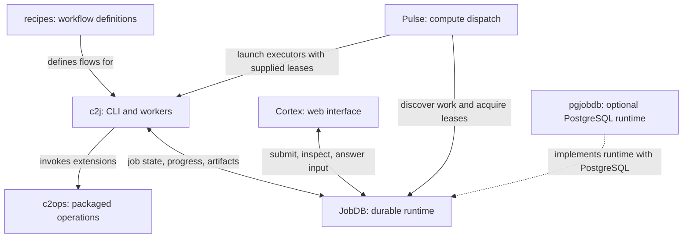

# C2: durable distributed workflow execution

C2 is a collection of projects for defining, running, and observing durable
workflows across workers and compute environments. Workflows preserve execution
progress, coordinate child jobs, and pause for dependencies or human decisions.
Recorded state lets work resume across execution sessions instead of relying on
one continuously running process.

The core is **recipes** for workflow definitions, **c2j** for execution,
**c2ops** for extension operations, **Pulse** for compute dispatch, and **Cortex**
for the human interface. **JobDB** supplies the shared durable runtime;
**pgjobdb** adds a PostgreSQL implementation option.

## How the system fits together



Recipes describe control flow, inputs, dependencies, and operations. c2j executes
that flow in workers and records progress through JobDB. Operations may be built
into c2j or supplied by packages such as c2ops, whose integrations include agents,
LLMs, GitHub Actions, and policy checks.

Pulse discovers eligible work across a JobDB tenant, acquires job leases, and
launches compatible executors on local Docker or configured remote/cloud
providers. Those executors run c2j with the supplied lease. c2j executes commands
and extensions directly in the provisioned worker environment; images, tools,
and isolation must already be available there.

Cortex connects to the same remote JobDB to submit and inspect jobs, view
execution stories and artifacts, restart jobs, and respond to human input or
document reviews. Workers run separately from the web interface.

## A workflow's journey

1. **Submit a recipe.** Use c2j or Cortex to submit a job with its inputs and
   target repository, called a cell. A cell covers an entire repository.
2. **Persist the job.** JobDB stores the job and coordinates durable execution
   state, leases, history, and artifact access.
3. **Dispatch eligible work.** In a distributed deployment, Pulse discovers work
   that needs an executor, acquires a lease, and launches c2j in a compatible
   environment with that lease.
4. **Execute and record progress.** c2j interprets recipe control flow, invokes
   operations, records completed work and artifacts, and coordinates child jobs.
5. **Yield or wait.** A workflow can wait for dependencies, human input, or an
   appropriate execution environment without keeping one worker running for the
   entire workflow lifetime.
6. **Resume from durable state.** When work becomes eligible again, execution
   continues using its recorded progress. Dispatch can supply another executor
   when needed.
7. **Inspect and respond.** Throughout execution, use Cortex to read the job's
   story and artifacts and answer pending inputs or reviews so work can continue.

For local use, c2j also supports direct execution and an embedded runtime.
The distributed path described above uses a shared remote JobDB service;
Cortex and Pulse connect to that remote runtime, not an embedded local database.
JobDB's SQLite backend supports durable storage, while its in-memory toy backend
is for experiments and tests. PostgreSQL is an option through pgjobdb.

Durability concerns recorded execution state and resumability. It does not
provide exactly-once external side effects or automatic recovery of arbitrary
commands. Recipe and operation authors must design appropriate retries and
side-effect handling.

## Core projects

Each project link opens its authoritative README with setup instructions and
further guides.

| Project | Responsibility |
| --- | --- |
| [c2j](https://github.com/colony-2/c2j/blob/main/README.md) | CLI and Go libraries for submitting, executing, continuing, and inspecting recipe jobs through JobDB. Owns recipe execution semantics; compute provisioning happens outside c2j. |
| [Pulse](https://github.com/colony-2/pulse/blob/main/README.md) | Discovers work across a JobDB tenant, acquires leases, and dispatches compatible c2j executors to local Docker or configured remote/cloud providers. |
| [Cortex](https://github.com/colony-2/cortex/blob/main/README.md) | Web interface for submission, inspection, artifacts, restarts, and human input or document review, backed by remote JobDB and separately running workers. |
| [recipes](https://github.com/colony-2/recipes/blob/main/README.md) | Shared development workflows, authoring guides, and native c2j scenarios. Combines operations into flows for consultation, review, prerequisite coordination, implementation, and verification. |
| [c2ops](https://github.com/colony-2/c2ops/blob/main/README.md) | Packaged extension operations with JSON input/output contracts for agent/LLM, GitHub Actions, and policy integrations. Recipes select published implementations explicitly. |

## Runtime and storage

| Project | Responsibility |
| --- | --- |
| [jobdb](https://github.com/colony-2/jobdb/blob/main/README.md) | Durable job runtime, public workflow APIs, and remote runtime server. Coordinates state, leases, history, and artifact access; supplies SQLite and in-memory backend options. |
| [pgjobdb](https://github.com/colony-2/pgjobdb/blob/main/README.md) | Typed PostgreSQL scheduler and JobDB runtime integration. Supplies the PostgreSQL runtime executable and container distribution using JobDB's public workflow core. |

## Execution environments and repository access

These supporting projects provide environment and access choices; they are not
required by every deployment.

| Project | Responsibility |
| --- | --- |
| [base](https://github.com/colony-2/base/blob/main/README.md) | Worker image and development tools, including c2j. The base2 image supports Pulse's shared Nix store integration; it supplies an environment rather than scheduling or workflow state. |
| [shai](https://github.com/colony-2/shai/blob/main/README.md) | Container sandbox tooling for agent and development commands, controlling workspace access, network access, and host integrations. Can provision controlled environments independently; c2j does not create a Shai sandbox per operation. |
| [gitvend](https://github.com/colony-2/gitvend/blob/main/README.md) | Gateway providing scoped short-lived Git credentials without exposing upstream GitHub credentials to agents. Its optional JobDB plugin bounds issued credentials by verified job lease authority. |

## Contextual assistant

[Cortex Assistant](https://github.com/colony-2/cortex-assistant/blob/main/PURPOSE.md)
is registered for the reusable assistant core, versioned protocol, and cell-local
session recipe. Its responsibilities include durable contextual conversations,
returned documents and files/media, finish and restart, and confirmed goal creation
for existing cells. Cortex owns browser and HTTP integration. The repository is
initialized with its purpose; serving implementation, recipe release, and consumer
integration remain pending subsequent consultation and implementation.

## Finding your way around

This repository, [c2-root](https://github.com/colony-2/c2-root), maintains the
project's cell catalog and routes general requests to the appropriate owner.
Its responsibilities are described in [PURPOSE.md](PURPOSE.md). Shared workflow
definitions live in the recipes repository.

The root catalog is [.c2/config.yaml](.c2/config.yaml). From this checkout, inspect
the configured repositories and their descriptions without submitting work:

```sh
c2j cells
c2j cells --json
```

The catalog uses `repo`/`description` mappings in `dependents`, a supported c2j
configuration form. Custom readers must accept that form rather than assuming
all entries are repository strings.

This repository's `build.sh` enforces a narrower source format for its catalog:
one final `dependents` section with block mappings, unquoted canonical repository
URLs, and folded `description: >-` values indented as in the existing entries.
Every source entry must match that format; flow mappings, string entries,
aliases, tags, and alternate indentation are rejected rather than skipped.
This lets the check detect duplicates before c2j deduplicates repositories,
using only the existing Python and c2j tools. It does not change c2j's supported
configuration formats. Run `python3 -m unittest discover -s tests -v` for isolated
catalog regression checks.

Start with recipes for workflow authoring, c2ops for extension integrations,
and c2j for execution and CLI usage. Use Pulse's README for executor provisioning
and Cortex's README for the web interface. Consult JobDB and pgjobdb for runtime
and storage setup. Each linked component README owns its installation details,
configuration, and release compatibility requirements.

When project responsibilities change, update catalog descriptions and this
overview together. Keep detailed operational instructions in the component
repositories so their owners can maintain them alongside the implementation.
